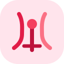

# GlowTap Customer App — Iconography & Illustration

Customer App visual asset library · Design reference · 04 November 2026

## Iconography and placement

| Artifact | Placement | Meaning / text | Size / colour / treatment |
|---|---|---|---|
| Bottom navigation | Fixed bottom dock | Home, Bookings, Notifications, Profile | SVG line icons, 20–24px; muted inactive, bright active |
| Search / filter | Search field or filter chip | Search salons; Filter | SVG 18–22px; ink or muted |
| Back / close / chevron | Header leading edge or dismiss control | Back, Close, View details | SVG 18–22px; ink |
| Status | Beside booking/payment/ticket status | Confirmed, Pending, Complete | 14–18px; pair icon with text and semantic colour |
| Category illustration | Category tiles | Hair, Facial, Makeup, Nails, Spa | Square 128×128 SVG, centered in tile |
| Avatar | Stylist/review row | Person identity and name | Portrait crop 40–56px |

## Icon rules

Use simple line icons with consistent stroke weight and rounded joins. Center each glyph in a larger tap target. Pair ambiguous symbols with a text label. Use violet for active controls and muted ink for inactive controls. Preserve third-party marks.

## Illustration artifacts

Category artwork is stored as vector SVG in Customer/assets/cats/.

## Screen placement matrix

| Screen / region | Asset placement | Adjacent text | Alignment |
|---|---|---|---|
| Home category grid | Artwork centered inside tile | Hair, Facial, Makeup, Nails, Spa | Illustration above or beside label |
| Search filters | Small glyph inside filter chip | Category name | Icon leading; label centered |
| Empty state | Larger illustration above message | “No bookings yet”, “Start exploring” | Center aligned; CTA below explanation |
| Stylist/review list | Avatar at leading edge | Person name, role, rating | Image beside stacked text |

SVG source files preserve proportions and remain editable.
