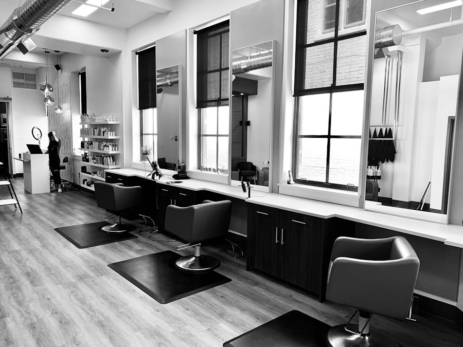

# GlowTap Customer App — TM Brand Logo & Visual Assets

Customer App identity and image inventory · Design reference · 04 November 2026

## Brand marks

| Asset | File | Placement | Size / colour / use |
|---|---|---|---|
| Wordmark | Customer/assets/glowtap-wordmark.svg | Splash, welcome, branded headers | SVG; preserve aspect ratio and source colour |
| Brand lockup | Customer/assets/glowtap-brand.svg | Larger identity placements | SVG; use full lockup when space allows |
| App icon | Customer/assets/glowtap-icon.svg | Launch/splash/app identity | Square SVG; center within platform mask |
| Brand mark | Customer/assets/glowtap-mark.svg | Compact brand stamp | SVG; use when wordmark cannot fit |
| Legacy logo | Customer/assets/glowtap-logo.svg | Existing screens | Check before new placements; prefer current named assets |

## Logo placement and text

| Context | Placement | Text | Treatment |
|---|---|---|---|
| Splash | Centered in brand field | GlowTap; “Tap · Book · Glow” | High-contrast wordmark, tagline beneath |
| Welcome/auth | Above form or provider actions | Welcome / sign-in prompt | Logo secondary to screen heading |
| Header | Leading or centered as screen pattern allows | Screen title | Compact; avoid competition |
| App icon | Launcher / platform icon | No extra text inside mark | Preserve safe area and mask |

## Image inventory

| File group | Placement | Role | Crop guidance |
|---|---|---|---|
| assets/photos/login-hero.jpg | Welcome/login hero | Beauty lifestyle image | Cover crop; keep subject clear of text |
| assets/photos/salon-*.jpg | Discovery and service cards | Salon/service photography | Card cover crop, rounded corners |
| assets/photos/stylist-*.jpg | Stylist rows and selection cards | Portraits | Consistent circular or rounded-square crop |
| assets/photos/promo-pay.jpg | Wallet / offers | Promotional artwork | Preserve offer legibility and contrast |
| assets/salon-bg.png; assets/wave-bg.webp | Decorative background | Brand atmosphere | Keep dense copy off busy areas |

## Visual artifacts

### Wordmark

### Customer app photography

Vector files are preferred for logos and icons; photographic assets remain raster. TM refers to the brand identity/logo section requested.
